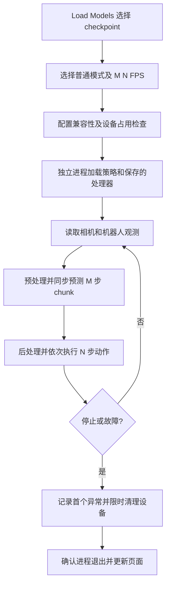
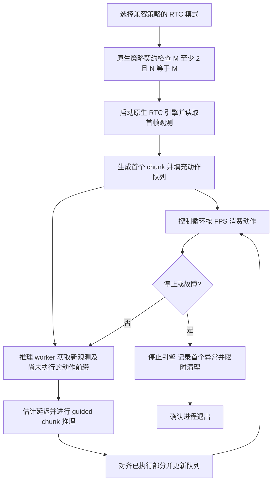

# 普通模式与 RTC

## 两条推理入口

**Load Models** 使用原生 LeRobot rollout，bridge 只提供浏览器会话、参数校验、观测展示和故障保护。**`/quantized`** 使用单独的 PI05 FP8 HTTP 模型服务以及本地控制循环。两者共享设备占用状态，但执行引擎和配置各自独立。

## 原生模式选择

| 模式 | 行为 | 限制 |
| --- | --- | --- |
| 自动 | 沿用模型/原 LeLab 的推理模式选择，包括 relative-action 策略的原生处理 | 与手动普通模式不完全相同 |
| 普通 | 强制同步 chunk 推理，清除已保存的 RTC 配置 | relative-action/某些特殊策略不允许强制此模式 |
| RTC | 强制启用 LeRobot guided RTC，保留动作队列并使用前缀指导下一 chunk | 当前开放 SmolVLA、PI0、PI05 的兼容配置 |

RTC 要求 `chunk_size >= 2`、`n_obs_steps == 1`，并排除不支持的视觉/本体记忆、历史观测与 temporal ensemble 配置。具体校验位于 [`native_modes.py`](../lelab/bridge/native_modes.py)。支持策略列表不是任意模型的保证；启动时仍须通过原生策略契约验证。

### M、N 与 FPS

- **M = chunk_size**：一次预测的动作数。
- **N = n_action_steps**：原生执行设置。普通模式可以执行每个 chunk 的 N 步；guided RTC 强制 `N=M`，由队列和原生 RTC 规则控制拼接。
- **FPS**：控制目标频率，不是模型每秒预测 chunk 的数量。

ACT 的 M 由训练结构固定；支持调整 M 的策略仍须满足原生配置约束。运行中修改任务和参数需要先重置到暂停状态再恢复。切换原生普通/RTC 模式需要停止任务后重启；浏览器里的重置不是电机急停。

RTC 启动参数由 `explicit_mode_flags()` 生成：`--inference.type=rtc`、`--inference.rtc.enabled=true`、`--inference.rtc.mode=guided`；前缀 horizon 限制为 `M-1`，队列阈值为 `min(30,M-1)`。`rollout.py` 负责启动独立子进程，`native_runner.py` 使用官方 `lerobot_rollout`，`native_session.py` 将交互控制接到浏览器。没有替换 SmolVLA 模型 forward 来模拟 RTC。

## 普通模式流程图

## RTC 模式流程图

两张图概括数据流；线程调度、延迟补偿和相对动作锚定由 LeRobot v0.7.0 的原生实现处理。RTC 让推理与执行重叠，并利用旧计划前缀改善衔接，但不会消除模型延迟、USB 故障或队列耗尽。实际任务效果需要对比验证。

## FP8 页面的差异与测速

`/quantized` 的普通/RTC 使用 [`control_loop.py`](../lelab/bridge/control_loop.py) 与 [`rtc_policy.py`](../rtc_policy.py)，支持运行中切换模式：模式 epoch 改变后丢弃旧请求结果，再建立新模式的动作缓冲。它不等同于原生 rollout 的模式切换。

模型服务返回 `inference_ms`，监视器展示最近一次 chunk 的推理时间。它不等于完整控制周期：USB 取帧、预处理、HTTP 传输、后处理和排队还有额外开销。比较时固定 checkpoint、硬件、M、denoising steps、FPS、相机配置，区分首次加载/预热与稳定运行；记录多次 chunk 的分布，而不是只报一次耗时。原生 rollout 的性能观测需结合其日志，不能直接把 FP8 服务数字套到普通模型。
